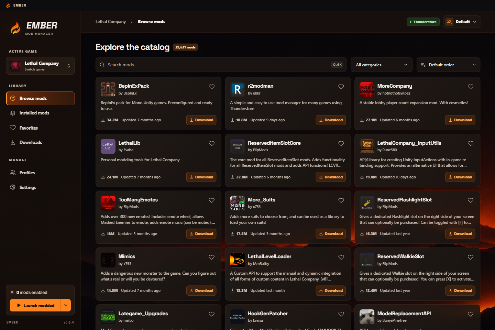

<div align="center">


# Ember

A Windows mod manager for Lethal Company, R.E.P.O., PEAK, and MIMESIS, powered by Thunderstore.

[](https://github.com/Ember-Mod-Loader/Ember/releases/latest)
[](LICENSE)

**[Website](https://embermods.org/)** · **[Download Ember](https://github.com/Ember-Mod-Loader/Ember/releases/latest)** · [What's new](RELEASE-NOTES.md) · [Report a bug](https://github.com/Ember-Mod-Loader/Ember/issues)

</div>

## Download

**[Windows installer](https://github.com/Ember-Mod-Loader/Ember/releases/latest)** · Recommended, with automatic updates.

[Portable app](https://github.com/Ember-Mod-Loader/Ember/releases/latest) · Run without installing. Update manually.

Windows builds are currently unsigned. Checksums are included with each release.



## Supported games

| <br>Lethal Company | <br>R.E.P.O. | <br>PEAK | <br>MIMESIS |
| :---: | :---: | :---: | :---: |

Ember finds supported games in your Steam libraries. If a game isn't found, choose its folder in **Settings**.

## Features

- Browse Thunderstore by search, category, downloads, or recent updates.
- See package tags and deprecated labels, with an option to include deprecated mods in searches.
- Install mods and their required packages together.
- Enable, disable, update, and remove individual mods, with prompts for affected dependencies.
- See available mod updates in Installed mods. When you open a profile, choose **Update now** or **Wait**.
- Keep separate profiles and share mod lists from Installed mods or Profiles with an Ember profile code.
- Follow downloads and launch your game with mods or in vanilla mode.
- Choose a wallpaper that stays selected across profiles and games.
- Redeem Ember codes in **Settings → Codes**.

No account is required. Profiles, preferences, and downloaded packages are stored on your device. The online indicator shows active app sessions; see [Privacy](PRIVACY.md) for details.

## Getting started

1. Open Ember and select your game.
2. Choose a profile, then install mods from **Browse mods**.
3. Select **Launch modded** and complete game setup if prompted.

Use the arrow beside the launch button to switch between modded and vanilla. Your profile stays intact.

<details>
<summary><strong>Game setup</strong></summary>

Close the game before changing its loader or preparing a profile. The setup panel in **Settings** lets you choose the game folder, prepare a profile, or open its folder.

Ember asks before adding a loader to a clean game installation. Compatible existing loaders are reused automatically. The launch button shows **Starting…** while Steam opens the game, then **Running** until it closes.

PEAK uses **BepInExPack_PEAK**; Lethal Company and R.E.P.O. use **BepInExPack**. MIMESIS uses **LavaGang's MelonLoader**, version 0.7.0 or newer. Keep mods for different loaders in separate profiles. If custom Steam launch options interfere, check **Steam → Properties → Launch Options** for that game.

Ember handles BepInEx plugins, patchers, configs, core libraries, and MonoMod patches, plus modern MelonLoader mods, plugins, libraries, and UserData. Package wrappers and explicit game-root or game-data files are recognized. Game-root files are backed up before replacement and restored when switching profiles, launching vanilla, or removing Ember's loader. If those files were edited, Ember keeps a recovery copy in the game folder.

Unrecognized loader layouts are reported with the affected path. Unreal-only loaders such as UE4SS aren't compatible with these Unity games. Ember doesn't run package installer scripts or replace game executables.

To remove a loader installed by Ember, choose **Remove loader** in the setup panel before uninstalling the app. Check mod listings for compatibility before installing.

</details>

<details>
<summary><strong>Sharing and importing profiles</strong></summary>

Choose **Profiles → Share profile → Create share code** to send a mod list to another Ember user. This uploads the profile to Thunderstore's sharing service. Anyone with the code can import it; creating and resolving codes requires internet access.

In **Import profile**, choose **Ember** for Ember codes or JSON files, or **Thunderstore / r2modman** for a code shared by either manager. For Thunderstore profiles, select the game the profile was made for. Ember shows any required version changes or unavailable mods before downloading, and keeps the enabled and disabled choices for the mods it imports.

Supported BepInEx configuration files and MelonLoader UserData text files are imported with the profile and applied when you prepare or launch it. If the archive contains files Ember can't place, it lists them for review before importing the supported files.

**Download JSON** saves a local export, including imported configuration templates. Later changes made by the game in its runtime configuration files aren't automatically copied back into exports.

Review a profile before sharing it, since exports can include its name, package list, and configuration.

</details>

<details>
<summary><strong>Dependencies and downloads</strong></summary>

If a mod needs a disabled requirement, Ember offers to enable the required mods together. Disabling or deleting a requirement lists the mods that depend on it. You can change just the selected mod or all affected mods. Choosing an override may leave dependent mods unable to load.

You can start another mod download while one is running. The **Downloads** tab shows progress and the destination profile. Completed entries clear after 30 seconds and failed entries clear after five minutes. Choose **Clear finished** to remove both types of history entries for the selected game.

</details>

<details>
<summary><strong>Client updates</strong></summary>

The installed app checks for updates on its loading screen, shows download progress, and reopens after installation. A running game or active profile work delays installation. Failed or stalled checks let you continue into the workspace.

Choose **Settings → Update client** to check for and download an available update. When it is ready, choose **Install and restart**. Ember installs silently and reopens. If active work blocks installation, finish that work and choose **Install and restart** again. Portable builds are updated manually from the release page.

If you're upgrading from 0.4.x, install a current release once to get automatic updates. Your profiles and preferences are preserved.

</details>

## Contributing

Ember's source is MIT licensed. Bug reports and contributions are welcome on [GitHub](https://github.com/Ember-Mod-Loader/Ember/issues).

<details>
<summary><strong>Run from source</strong></summary>

Use **Node.js 24**. Desktop packaging requires Windows.

```powershell
npm ci
npm start
```

| Command | Purpose |
| --- | --- |
| `npm run dev` | Develop the renderer |
| `npm test` | Run the test suite |
| `npm run build` | Build the renderer |
| `npm run package` | Test and package the Windows builds |

See [CONTRIBUTING.md](CONTRIBUTING.md) for development and release instructions, and [SECURITY.md](SECURITY.md) for reporting security issues.

</details>

[License](LICENSE) · [Privacy](PRIVACY.md) · [Third-party notices](THIRD-PARTY-NOTICES.md) · [Contributing](CONTRIBUTING.md)

Ember is an independent project, not affiliated with Thunderstore, Steam, or the game developers. Game artwork, mod branding, and third-party libraries retain their respective ownership and licenses.
