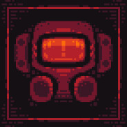
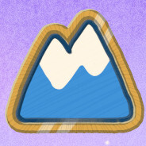

<div align="center">


# Ember

**Power your mods.**

A clean Windows mod manager for Lethal Company, R.E.P.O., and PEAK.

[](https://github.com/Ember-Mod-Loader/Ember/releases/latest)
[](https://github.com/Ember-Mod-Loader/Ember/releases/latest)
[](LICENSE)

**[Download Ember](https://github.com/Ember-Mod-Loader/Ember/releases/latest)** · [Release notes](RELEASE-NOTES.md) · [Report a bug](https://github.com/Ember-Mod-Loader/Ember/issues)

</div>

## Get Ember

Open the **[latest release](https://github.com/Ember-Mod-Loader/Ember/releases/latest)** and choose your Windows x64 download. The files above are the app's source code; you don't need them to install Ember.

| Download | Choose this if… |
| --- | --- |
| **[Windows installer](https://github.com/Ember-Mod-Loader/Ember/releases/latest)** · ends in `-Setup.exe` | You want Ember installed with automatic client updates. Recommended. |
| **[Portable app](https://github.com/Ember-Mod-Loader/Ember/releases/latest)** · ends in `-x64.exe` | You want to run Ember without installing it. Update this build manually. |

Both builds keep profiles and settings in local app data. Windows builds are currently unsigned. Release downloads include `SHA256SUMS.txt` for verification.

## Your games. Your profiles.

| <br>Lethal Company | <br>R.E.P.O. | <br>PEAK |
| :---: | :---: | :---: |
| Windows · Steam | Windows · Steam | Windows · Steam |

Browse each game's Thunderstore catalog, install mods with their dependencies, and keep separate profiles. Ember finds games in your Steam libraries and supports **modded** and **vanilla** launch. If a game isn't found, select its installation folder in **Settings**.

- **Find your next mod.** Search, filter by category, and sort by downloads, recent updates, rating, or newest. More results load automatically.
- **Keep control of your collection.** Enable, disable, update, or remove individual mods. Dependency prompts explain which other mods are affected.
- **See what's happening.** Follow package progress in Downloads and check the installed and enabled counts for your current profile.
- **Make it yours.** Choose one of six wallpapers. Your background stays with you across profiles, games, and restarts.

## Start playing

1. Install your game through Steam, then open Ember and select it.
2. Choose a profile or create a new one. Find mods in **Browse mods** and choose **Download**.
3. Check **Installed mods**, then choose **Launch modded**. Complete game setup if Ember prompts you.

Use the arrow beside the launch button to select **Modded** or **Vanilla**. Changing the mode updates the button; the game starts when you press the launch button.

<details>
<summary><strong>Game setup and launch help</strong></summary>

Close the game before preparing a profile or changing its loader. In **Settings**, use the game's setup panel to choose its Steam folder, **Prepare profile**, or open the prepared profile folder.

On a clean game installation, Ember asks before adding the BepInEx Doorstop loader to the game folder. A compatible existing loader can be reused. Ember remembers approval for that folder and checks again if the loader files change.

Use the BepInEx package intended for your game: **BepInExPack_PEAK** for PEAK, and **BepInExPack** for Lethal Company or R.E.P.O. If custom Steam launch options interfere, review them in the game's **Steam → Properties → Launch Options**.

Use **Remove loader** in the setup panel to remove a loader installed by Ember before uninstalling the app. Install mods you trust and check their Thunderstore listings for compatibility.

</details>

<details>
<summary><strong>Profiles, dependency prompts, and downloads</strong></summary>

**Share a profile.** Choose **Profiles → Share profile → Create share code** for a short `EMBER-…` code that works on another device running Ember. This uploads the selected profile to Thunderstore's sharing service; anyone with the code can import it. Creating and resolving short codes needs internet access. Ember codes are supported; native Thunderstore/r2modman archive codes are not.

**Keep an offline copy.** **Download JSON** exports a profile. **Import profile** accepts Ember codes, older `MR1-…` codes, and Ember JSON exports, then downloads the profile's package versions.

**Choose how dependencies change.** Enabling a mod with disabled requirements offers **Enable required mods**, **Enable anyway**, or **Cancel**. Disabling a required mod offers **Disable affected mods** or **Disable anyway**. Removing one lists its installed dependents and offers **Delete anyway** for that mod alone, or removal of all affected mods. Overrides can leave mods unable to load until their requirements are restored.

**Track downloads.** **Downloads** shows progress and the destination profile. Completed entries clear after 30 seconds or with **Clear completed**. Active downloads and failures stay visible. Clearing history doesn't delete installed mods or cached ZIP files. **Installed mods → Open downloads** opens the archive folder.

**Reset sorting.** Choose **Default order** or **Clear sorting** to return to Thunderstore's standard order.

</details>

<details>
<summary><strong>Wallpapers</strong></summary>

Choose **Settings → Wallpapers** for **Main**, **Ember Flow**, **Aurora**, **Obsidian**, **Crimson Dunes**, or **Solar Drift**. Main is the default. Your choice is shared across profiles and used on the loading screen.


</details>

<details>
<summary><strong>Client updates</strong></summary>

Installed Windows clients check GitHub Releases at startup and download newer stable releases. Ember restarts to install when the game is closed and no download, profile operation, or editing dialog is active. **Settings → Update client** shows progress, retry, and **Install and restart**. A failed check leaves your workspace usable.

Portable builds use the release page for manual replacement.

**Upgrading from 0.4.x:** install a current release once using the installer. Older builds can't start the new updater automatically. Your existing profiles, mods, wallpaper preferences, and caches are preserved.

</details>

## Open source

Ember's source is **MIT licensed**. Contributions and bug reports are welcome. Third-party libraries, game artwork, mod branding, and trademarks keep their own licenses and ownership.

<details>
<summary><strong>Build, contribute, or publish a release</strong></summary>

Use **Node.js 24**. From the project folder:

```powershell
npm ci
npm start
```

Use `npm run dev` for renderer development, `npm test` for offline checks, and `npm run build` for the production renderer. `npm run package` tests and builds Windows x64 installer and portable artifacts.

To publish an update, change the version in `package.json` and `package-lock.json`, update `RELEASE-NOTES.md`, then push to `main`. The Windows workflow tests and packages the exact commit, uploads the builds, updater metadata, blockmap, checksums, and notices to a draft, then publishes the complete stable release. Existing release versions aren't overwritten.

Read [CONTRIBUTING.md](CONTRIBUTING.md) for contribution and release guidance, and [SECURITY.md](SECURITY.md) for reporting security issues.

</details>

[License](LICENSE) · [Privacy](PRIVACY.md) · [Third-party notices](THIRD-PARTY-NOTICES.md) · [Contributing](CONTRIBUTING.md)

Ember is independent of Thunderstore, Steam, and the game developers. Thunderstore provides the mod catalog and package downloads.
